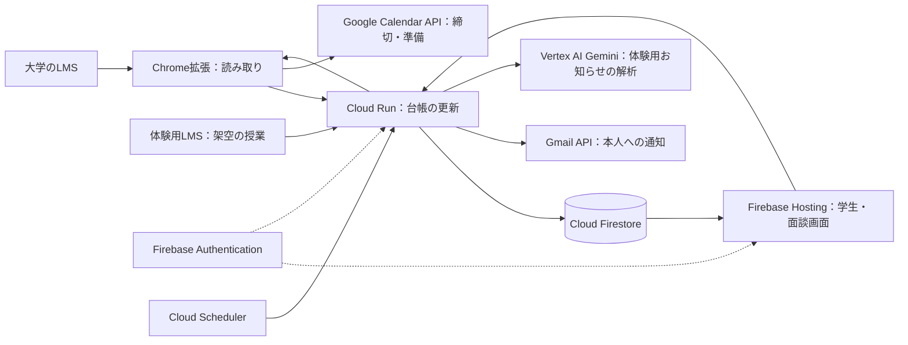

# ToDoku（トドク）

ToDokuは、大学の授業支援システム（LMS）から課題と締切を集め、課題の管理が苦手な学生と、その学生を支える支援担当が一緒に使うアプリです。

- 学生は、授業ごとの課題と締切を時間割で確認し、取り組む時間を「準備の予定」として入れられます。通知を有効にすると、やることがある日の朝にメールで確認できます。
- 支援担当は、学生が共有を許可した課題の一覧と締切の変更を見て、次にやることと準備の予定を一緒に決められます。

大会後向けの開発ブランチでは、学生画面と面談の「① 確かめる」に「最近の締切変更」を追加しています。過去7日間の記録から、課題ごとの最後の変更前後を確認できます。提出版には未反映です。[方式比較と確認結果](docs/records/2026-11-10-f1.md)を参照してください。

[紹介ページ](https://todoku.me/) · [体験用LMS](https://todoku.me/demo-lms)

体験は上の体験用LMSから、拡張不要で試せます。実際のLMSとChrome拡張を使う場合は、[Releaseの拡張ZIP](https://github.com/Devfest-Hackathon-2026/df-2026-t198/releases/tag/v1.0.0-submission)を取得し、[web.appの学生画面](https://project-00439085-4e2d-44c3-9a8.web.app/student)を使います。拡張の接続先は現在 web.app のURLです。

## ブラウザで試す

体験用LMSの「学生として試す」から、架空の授業で試せます。説明資料の個別の組へのリンクも使えます。拡張機能は不要です。

1. 「体験を最初からやり直す」で初期化し、「LMSを開く」を押します。
2. 「締切を1日延ばす」を押します。まずLMSだけが変わり、自動の読み取り後に学生・支援担当の枠も変わります。
3. 「朝のメールを見る」で見本を開きます。「終わった」「後回し」は確認欄でもう一度押すと、準備の予定に反映します。
4. 学生・支援担当の枠にある「大きく開く ↗」で詳しい画面を見られます。支援担当本人として同時に試す場合は、別のブラウザで同じ組の支援担当として入ります。

体験では実際のGoogleカレンダーへの書き込みやメール送信は行いません。「終わった」は準備の記録で、LMSへの提出は別です。共用の体験はほかの人と同じデータを使います。詳しい操作と終了時の手順は [体験ガイド](docs/demo.md#手で試す) にあります。

## 実際のLMSで使う場合

初回はChrome拡張の導入とGoogle連携が必要です。[Release](https://github.com/Devfest-Hackathon-2026/df-2026-t198/releases/tag/v1.0.0-submission)の拡張ZIPを展開し、Chromeの `chrome://extensions` でデベロッパーモードを有効にして、展開した拡張のフォルダを読み込みます。自分でビルドする場合は、[Google接続の設定手順](spikes/auth-probe.md)に沿ってOAuthとFirebaseを設定し、`pnpm --filter extension build` の後に `packages/extension/dist` を読み込みます。拡張と学生画面は同じGoogleアカウントでログインし、LMSには本人が通常どおりログインします。拡張は取得後の待機中には取り直さず、次の取得で変更を反映します。サーバーはLMSのID・パスワード・セッションIDを預からず、LMSへの提出も行いません。

拡張を導入した後は、[学生画面](https://project-00439085-4e2d-44c3-9a8.web.app/student)を使ってください。学生画面と拡張の連携は現在 web.app のURLだけで動くためです。

メールは、本人が「メール通知の設定」でクラウド通知を有効にした場合に、Cloud SchedulerからCloud Runを起動し、専用Gmailから本人へ送ります。日本時間7:30以降の朝のまとめと、準備の開始30分前から開始前までの通知があり、対象がないときは送りません。PCを閉じている間もクラウド通知は動きますが、LMSの新しい変更の取得と実際のGoogleカレンダーの更新にはPCの拡張の動作が必要です。切替前の拡張送信はChromeの起動が必要です。設定と切替条件は [通知の運用手順](docs/deploy.md#拡張のメールからクラウド通知へ移すissue-163) を参照してください。

## 構成とGoogleの技術

共通の核と、LMS製品ごとの読み取り定義に分けています。横浜国立大学のCoursePower、京都大学のKULMS（Sakai）とKULASISの取得部品があります。



| 技術 | 役割と選んだ理由 |
|---|---|
| Chrome拡張（Manifest V3） | 本人のログイン済みLMSを読み、認証情報をサーバーに預けずに課題を取得する |
| Cloud Run | 台帳の更新、通知、準備の操作をAPIに集め、権限の確認と保存を一か所で行う |
| Cloud Firestore | 課題と変更履歴を保存し、学生・支援担当の開いた画面へ変更を反映する |
| Firebase Hosting / Authentication | Web画面の配信とログインを提供し、APIでも本人を確認する |
| Google Calendar API | 普段のカレンダーで締切と準備を見られるように、拡張から専用カレンダーを更新する |
| Cloud Scheduler / Gmail API | PCの起動に依存せず定期処理を動かし、普段使うメールで本人に知らせる |
| Vertex AI Gemini | 表の値だけでは扱えないお知らせの文章から締切変更の候補を拾う。現在は体験版の架空のお知らせが対象で、公式の締切は上書きしない |
| Cloud Build / Artifact Registry | APIをコンテナにビルドして保管し、Cloud Runへ配備する |

コードは `packages/extension`（Chrome拡張）、`server`（API）、`web`（React + Vite）、`core`（共通の型と読み取り）に分かれています。読み取り定義と架空の見本は `lms-definitions/` にあります。

## 確かめた範囲

| 対象・確認日 | 結果と限界 |
|---|---|
| 横国の本人アカウント・11/7 | 23/23授業の一覧取得、表示された未提出12課題の題名・締切・状態と実LMS詳細の一致、実Googleカレンダー12/12件の一致と再取得時の重複なしを確認。実物での締切移動・取消は未確認。[確認記録](docs/records/2026-11-07-c43-live.md) |
| 京大の本人アカウント・11/9 | KULMSの20授業・失敗0件、KULASISの時間割と学生画面7/7件の一致を確認。期間内の対象課題が0件のため実課題の読み取り精度は未測定。[確認記録](docs/records/2026-11-09-issue-152.md) |
| クラウド通知・11/9 | 朝と準備前の2件の送信受理を確認し、本人から受信報告あり。2通それぞれの到達と送信元表示名の照合は未完了。[経過の記録](docs/records/2026-11-10-notification-status.md) |

各確認はその日の対象アカウントでの結果です。多数の利用者によるLMSの負荷や、利用者の作業時間の削減効果は未測定です。

## 手元で動かす

Node.js 26、pnpm 11、JDK 21以上で、Googleアカウントやクラウドの設定なしに、架空データを使う体験を起動できます。初回のダウンロードにはネットワーク接続が必要です。[体験ガイドの起動手順](docs/demo.md#手元で動かす) を参照してください。

## 開発と確認

```sh
pnpm install --frozen-lockfile
pnpm typecheck && pnpm lint && pnpm test && pnpm build
pnpm progress --check && pnpm check:samples
```

手順と構成の詳細は [体験ガイド](docs/demo.md)、[デプロイ手順](docs/deploy.md)、[データの形](docs/data-shapes.md)、[選定理由](docs/decisions.md) にあります。

[MIT License](LICENSE)。外部の依存・素材とライセンスは [docs/third-party.md](docs/third-party.md) を参照してください。
