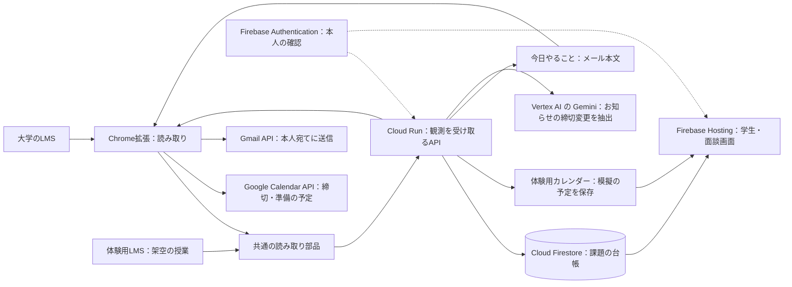

# 課題の秘書（仮称）

大学の授業支援システム（LMS）から課題を集め、学生の時間割・締切のカレンダー・支援担当の面談画面にまとめるアプリです。

架空の授業で、締切の変更、準備の予定の保存、「今日やること」のメール見本を、Chrome拡張なしで試せます。

## ブラウザで試す

[体験用LMSを開く](https://project-00439085-4e2d-44c3-9a8.web.app/demo-lms)。体験用の学生・支援担当のアカウントは提出の説明資料に記載します。公開先でも、下の「手元で動かす」の環境でも、次の1〜6で試せます。

1. 学生用のブラウザで体験用LMSにログインします。ほかの人が試した後は締切が延びたままのことがあるため、「体験を最初からやり直す」を押して最初の状態に戻します。「架空の観察ノート」の締切を確かめてから、「LMSを開く」を押します。
2. 「学生の画面を開く」を押すと、別のタブに時間割が開きます。「架空の観察入門」のマスを押します。「架空の観察ノート」の締切と、時間割の上の「締切のカレンダー」の予定を確かめます。この画面を開いたままにします。
3. 別のブラウザか別のプロファイルで、支援担当として体験用LMSにログインします。「面談を開く」から学生を選び、「次の面談までの締切」を確かめます。この画面も開いたままにします。同じブラウザの別タブでは役割を分けられません。
4. 学生用ブラウザの最初のタブの体験用LMSに戻り、「3. 先生役で締切やお知らせを変える」の締切を1日延ばすボタンを押します。LMSの締切だけが変わり、学生の画面と面談画面はまだ変わりません。
5. もう一度「LMSを開く」を押します。開いたままの学生の画面（右の授業の欄・時間割のマス・締切のカレンダー）と面談画面の「次の面談までの締切」が、再読み込みしなくても1日延び、面談画面の「前回の面談からの変化」に締切の変更が出ます。「② 相談する」で候補の「入れる」を押し、開始・終了時刻を入れてもう一度「入れる」を押します。学生の時間割に準備が入り、一覧に「支援担当が入れました」と出たら、学生側で「外す」を押します。面談画面は「① 確かめる」に戻して開いたままにします。
6. さらに「LMSを開く」を押し、カレンダーの「架空の観察ノート」が1件、面談の締切の変更が1行のままであることを確かめます。体験用LMSで「今日の準備の見本を用意する」を押すと、メールの見本が出ます。「🕒 後回し」で翌日以降の空いたコマへ動くことを確かめ、もう一度見本を用意して「✅ 終わった」を押します。両画面の「入れた準備の予定」が「終わった（LMSへの提出は別）」になることを確かめます。先生役の欄で「お知らせを出す」の後に「LMSを開く」を押すと、公式の締切は変わらず、学生・面談画面に「要確認」が出ます。終わったら体験用LMSで「体験を最初からやり直す」を押し、両方のブラウザでログアウトします。

体験用カレンダーは保存された模擬の予定です。実際のGoogleカレンダーには書き込みません。操作に失敗したら、同じ「LMSを開く」で再試行できます。実際のLMSからの取得とGoogleカレンダーへの反映は、通しての動作確認が残っています。準備の予定は学生の画面からも入れられ、学生はどちらが入れた予定も外せます。「終わった」は準備の記録で、LMSへの提出は別に行います。メールの見本から実際のメールは送りません。

## 手元で動かす

Node.js 26、pnpm 11、JDK 21以上が必要です。pnpmの固定版は [package.json](package.json) の `packageManager` を参照してください。`node --version`・`pnpm --version`・`java -version` で確認できます。初回は依存とエミュレーターのダウンロードにネットワーク接続が必要です。Googleのアカウントやクラウドの設定は不要です。

repoのルートで準備します。

```sh
pnpm install --frozen-lockfile
pnpm build
```

8080・5177・8085・9099番ポートが空いている状態で、3つのターミナルをrepoのルートに開きます。エミュレーターの画面と制御には4000・4400・4500・9150番も使います。実際の使用ポートは、ターミナル1の起動時の一覧で確認してください。使用中なら、その作業が終わるのを待つか自分で起動したものだけを終了してください。

**ターミナル1：認証とデータ保存を起動**

```sh
pnpm exec firebase emulators:start --project demo-kadai-hisho --only auth,firestore
```

JavaがPATHにないmacOSでHomebrewのJDK 21を使う場合は、先に `export PATH="/opt/homebrew/opt/openjdk@21/bin:$PATH"` を実行します。

**ターミナル2：架空のアカウントを用意してAPIを起動**

```sh
export GCLOUD_PROJECT=demo-kadai-hisho
export FIRESTORE_EMULATOR_HOST=127.0.0.1:8085
export FIREBASE_AUTH_EMULATOR_HOST=127.0.0.1:9099
read -s KADAI_DEMO_PASSWORD
export KADAI_DEMO_PASSWORD
node packages/server/scripts/seed-demo.mjs
unset KADAI_DEMO_PASSWORD
PUBLIC_WEB_ORIGIN=http://127.0.0.1:5177 node packages/server/dist/index.js
```

`read -s` の行で止まったら、8文字以上の手元用パスワードを入力しEnterを押します。入力は画面に出ません。ログインで使うので覚えておき、文書やログには残さないでください。初期設定の成功メッセージを確認してからAPIを起動します。既存のアカウントのパスワードや変更済みの締切は、初期設定をやり直しても戻りません。

**ターミナル3：APIの起動を確認して画面を起動**

```sh
curl --fail --silent --show-error http://127.0.0.1:8080/api/health
```

`{"status":"ok"}` が返れば、APIがリクエストを受けられる状態です。接続できない場合は、ターミナル2でAPIが動いているか確認してください。起動を確認してから、同じターミナル3で画面を起動します。

```sh
VITE_USE_FIREBASE_EMULATORS=true pnpm --filter web exec vite --host 127.0.0.1 --port 5177 --strictPort
```

[手元の体験用LMS](http://127.0.0.1:5177/demo-lms) を開きます。学生は `trial-student@example.invalid`、支援担当は `trial-supporter@example.invalid` と、先ほど入力した共通の手元用パスワードでログインします。「ブラウザで試す」の1〜6を実行してください。学生の画面は `/student`、面談画面は `/session` です。

終わったら各ターミナルでCtrl+Cを押して終了します。この手順ではエミュレーターのデータをファイルへ保存しないため、停止すると試した内容は失われます。

## 構成とGoogleのサービス



図の実LMS・実カレンダーへの経路は、一連の動作の確認が残っています。体験ではブラウザの読み取り部品からAPIへ送り、模擬の予定を保存します。

| Googleのサービス | 使う場所 |
|---|---|
| Firebase Hosting | 学生・面談画面と体験用LMSの配信、APIへの転送 |
| Cloud Run | 観測を受け取り、課題の変更を台帳に記録するAPI |
| Cloud Firestore | 授業・課題・変更履歴・共有許可・模擬予定の保存と画面への即時反映 |
| Firebase Authentication | 学生と支援担当のログイン、APIでの本人確認 |
| Google Calendar API | Chrome拡張から実際の締切・準備の予定を作成・変更・削除。体験用アカウントでは使わない |
| Gmail API | 本人が拡張機能の設定で有効にしたときだけ、本人宛てに「今日やること」を送信。メールの読み取りはしない |
| Vertex AI の Gemini | お知らせから締切変更の候補を拾い、公式の締切を変えずに「要確認」にする。別のLMSの読み取り定義の下書きにも使用 |
| Cloud Build / Artifact Registry | APIのビルドとコンテナの保管 |

「今日やること」は、本人が拡張機能の設定で有効にしたときだけGmailへ送り、内容・送信時刻・必要な許可は [メール送信の条件](docs/data-shapes.md#今日やることのメール送信issue-113) で説明しています。

## 開発と確認

```sh
pnpm typecheck && pnpm lint && pnpm test && pnpm build
pnpm progress --check && pnpm check:samples
pnpm test:demo:emulator
```

ブラウザ操作の自動確認には、手元にPlaywrightとChromiumも必要です。既存のPlaywrightの `index.mjs` への絶対パスを指定します。用意がない場合は、上の手動手順で試せます。

```sh
PLAYWRIGHT_MODULE=/path/to/playwright/index.mjs pnpm metrics:m6
```

自動確認は認証・Firestoreのエミュレーターと画面・APIを起動し、学生と支援担当のログイン、締切変更、両画面と模擬予定への反映、応答を失った後の再送を確かめます。試験用パスワードは実行時に生成し、表示しません。結果は `/tmp/kadai-i19-evidence/m6.json`、画面の画像は同じフォルダに保存します。終了時に起動したプロセスを停止します。ほかのエミュレーターは先に終了しておいてください。

### 画面

公開用のビルドには `VITE_FIREBASE_PROJECT_ID`・`VITE_FIREBASE_API_KEY`・`VITE_FIREBASE_AUTH_DOMAIN` にFirebaseのWeb用設定を指定します。管理用の秘密鍵やトークンは使いません。設定がなければ準備中の案内が出ます。既存のFirebaseプロジェクトでGoogleログインと画面のドメインが許可されていることが前提です。反映の手順は [デプロイ手順](docs/deploy.md) にあります。手元で試す場合は、上のエミュレーターの手順を使ってください。

Chrome拡張は `pnpm --filter extension build` の後、Chromeの `chrome://extensions` でデベロッパーモードを有効にし、`packages/extension/dist` を「パッケージ化されていない拡張機能を読み込む」で選びます。Google接続には別途OAuthとFirebaseの設定が必要です。体験用LMSには拡張機能の設定は不要です。

開発用repoは `shieikan/kadai-hisho` です。構成と作業の規則は [AGENTS.md](AGENTS.md)、実装済みと未確認の範囲は [PLAN.md](PLAN.md)、データの意味は [docs/data-shapes.md](docs/data-shapes.md)、選定理由は [docs/decisions.md](docs/decisions.md) にあります。詳しい確認・運用は [体験用LMS](docs/demo.md)、[面談画面](docs/session-development.md)、[デプロイ手順](docs/deploy.md) を参照してください。

[MIT License](LICENSE)。外部の依存とライセンスは [docs/third-party.md](docs/third-party.md) に記録しています。
