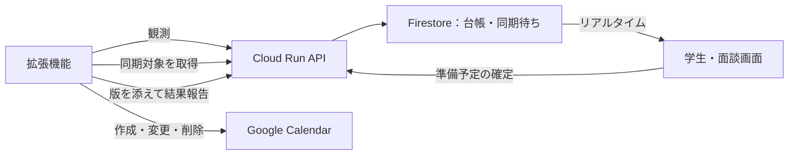

# 設計案：部品のつなぎ目（状態：案、2026-11-06）

## この文書の読み方

この文書は、ClaudeとAstraが2回話し合って合意した「各部品のつなぎ目」の設計案です。すでに決まっている基本方針（D1の部品の分け方、D7のLMSを開いたときに取得する仕組み、D8の画面を邪魔しない方針、D9の3層構造、D10のGoogleのサービス構成、D11の追加要件、D13の画面構成、および `docs/data-shapes.md` の観測データの基本形）は繰り返さず、部品同士をどうつなぐかだけをまとめています。各節では、採用する案とその理由、採用しない案、関係するPLANの完成条件（C番号）や指標（M番号）を示しています。

インフラを担当するorangeは、この文書を読んで、末尾にある「orangeに合意してほしいこと（1〜10）」に対する返事をGitHubのPRのコメントに書いてください。問題がなければ「合意」、変えたいところがあれば「ここを変えたい」とコメントしてください。合意できた内容は `docs/decisions.md` にD16以降として移し、`docs/data-shapes.md` と `packages/core/src/types.ts` を直します。

D23などで取りやめた案には、以下の要点と該当節に注記しています。現行のデータ契約は [data-shapes.md](data-shapes.md) を参照してください。注記で取りやめた案は実装の指示として扱いません。

## 要点

1. 学生の画面と面談画面はFirestoreから直接データを読み取り、データの書き込みはすべてCloud RunのAPIを経由します。
2. Firestoreのデータは `students/{uid}` の下に置き、支援担当との共有は「対象データを一括で見せるか、取り消すか」だけに絞ります。
3. LMSの観測データには1回ごとのIDを付け、再送を判別します（通し番号はD23で取りやめ。今の作りは `observationId` で再送を判別し、異なるIDは到着・トランザクションの処理順に適用します）。一覧と詳細の読み取りの成否を分け、詳細だけの失敗で課題を取り消しにしません。
4. 拡張機能とWeb画面は同じFirebaseプロジェクト・同じGoogleアカウントでログインし、APIへの通信にはFirebaseのID tokenを使います。
5. Googleカレンダーへの書き込みは拡張機能だけが行い、Firestoreに保存した「目標の状態と版」をもとに同期します。
6. 拡張機能なしで試せる「模擬LMS」はWeb画面で描き、同じ読み取り部品と観測APIを通します（Cloud Runで人ごとのHTMLを作る案はD23で取りやめ。今の作りはFirestoreの本人の体験データから描いたDOMを読み取ります）。
7. 支援担当との共有は一度限りの招待コードで学生本人が許可し、準備予定は学生と共有中の支援担当が入れられ、学生がどの予定も外せるようにします（Issue #49、D25。orangeの合意はmerge前）。

## 全体の流れ



## 1. データの書き込み先と読み取り先の分担（C11〜C14、C18〜C20、C23〜C26）

学生の画面と面談画面は、Firestoreから直接データを読み取ります（C20のリアルタイムの更新を行うためです）。一方で、データの書き込みはすべてCloud RunのAPIで行い、画面からFirestoreへの直接の書き込みはFirestoreの規則（セキュリティルール）で拒否します。拡張機能はFirestoreを直接読まず、Cloud RunのAPIとだけ通信します。

サーバー側の書き込みに使うAdmin SDKはFirestoreの規則を通らないため、APIのプログラム側でも「本人であるか」「共有の許可があるか」を確かめます。規則とAPIの両方を試験します。

書き込みをAPIに集める理由は、複数のデータの更新を1つのトランザクションでまとめられるからです。トランザクションとは、複数のデータの読み書きを「すべて書き込むか、1つも書き込まないか」のどちらかに揃える仕組みです。これにより、「観測からの台帳の更新とカレンダーの同期対象の更新」を安全に一度で処理できます。

Firebase Hostingの設定では、`/api/**` への通信をCloud Runへ転送します。この設定は、単一ページアプリ（SPA）用の `**` の設定より前に置きます。

- **採用しない案**：画面からFirestoreへ直接書き込み、後から別の処理がその変更を拾う方式は採用しません。

## 2. Firestoreのデータの置き方と共有の範囲

学生ごとのデータは `students/{uid}` の下に置きます。誰がどの文書を読めるかの区分けは次のとおりです。

| 読める人 | 文書 |
|---|---|
| 本人と、許可した支援担当 | `courses/{courseKey}`（授業名、曜日・時限）、`assignments/{key}`（題名、締切、提出の状態、取消の状態、要確認）、`changes/{changeId}`（変更の履歴）、`fetchStates/{system}`（取得の状態）、`plans/{planId}`（確定した準備の予定）、`sessionContext/current`（前回・次回の面談の日時） |
| 本人だけ | `calendarItems/{itemKey}`（カレンダーの同期対象）、`integrations/calendar`（専用カレンダーと接続の状態）、`observationReceipts/{observationId}`（観測の受領記録） |
| 本人と、その支援担当だけ | `supporters/{supporterUid}`（共有の許可）。他の支援担当には見せない |
| サーバーだけ（取りやめ） | `invites/{codeHash}` はD23で取りやめ。招待コードは作らず、体験用の共有許可は初期設定で作る |

共有の範囲は、今回は「見せる・見せない」の一括設定と、その取り消しだけを作ります。許可の文書（`supporters/{supporterUid}`）に `scopes: ['all']` を持たせ、この `all` は上の表の1行目にある文書の一覧だけを指すことにします（後から足す本人だけの情報は含めません）。項目ごとに共有範囲を選べる機能は今回は作りません。もし作るなら、文書の分け方と規則の変更が必要です。

変更の履歴は、課題の文書（`assignments`）の中の配列にはせず、`changes` に別の文書として置きます。Firestoreの1つの文書には1 MiBまでの大きさ制限があることと、面談画面で「前回からの変化」を授業をまたいで読み取る必要があるためです。また、現在のプログラムの型である `LedgerAssignment` はそのままの形では保存せず、プログラムの型と保存する文書を変換する関数を用意します。

Firestoreの規則を書くときは、共有するコレクションを1つずつ明記し、`students/{uid}` の下を再帰的にまとめて許可することはしません。Firestoreの規則は「読めない行だけを取得結果から自動で取り除く仕組み」ではなく、データを取得するクエリ側にも規則と一致する条件が必要なためです。

学生が共有を取り消したら、新しい読み取りをすぐに拒否し、開いている面談画面の表示も消します。ただし、すでに相手の画面に渡った情報を回収できるとは説明しません。また、全データの削除機能は今回は作りません。準備用の資料のP2（共有の変更・取消・全データの削除がすぐ反映される）のうち、全削除は対象外と明記します。Firestoreでは親の文書を消しても下のコレクションは消えないため、将来作るときは消す範囲を決めて作ります。

## 3. 観測データの形と受け取り時の決まり（C02〜C04、C06、C10〜C14、M1・M4・M7）

注記：通し番号はD23で取りやめました。今の作りは [data-shapes.md の「応答と再送」](data-shapes.md#応答と再送) のとおり、`observationId` と受領結果だけで再送を判別します。`sequence`・`payloadHash`・`lastAppliedSequence` は持たず、古い観測の順序判定や同じIDの内容の衝突検出は行いません。以下の表の取りやめ・未実装の項目を現行の契約に追加しません。

| 対象 | 項目 | 意味 |
|---|---|---|
| 観測 | `schemaVersion` | 観測の書式の版 |
| 観測 | `observationId` | 取得1回のID（UUID）。送信を再試行しても変えない |
| 観測（取りやめ） | `sequence` | D23で取りやめ。今は異なるIDを到着・トランザクションの処理順に適用する |
| 観測 | `system` | 製品名ではなく接続先（`ynu-lms`、`panda`、模擬LMS用の `demo-lms`）。製品の定義は `definitionId`（例：`coursepower`）で表す |
| 観測 | `definitionId`、`definitionVersion` | 読み取りに使った定義と、その版 |
| 観測 | `fetchedAt` | 取得した時刻。表示と根拠に使い、順序には使わない |
| 観測 | `catalogCourses` | ホームで見つけた授業。課題の一覧を取れたかとは分ける |
| 観測 | `courseResults[]` | 授業ごとに `courseId`、`listComplete`（一覧を最後まで取れたか）、`seenSourceIds`（一覧にあった課題のID） |
| 課題の観測 | `deadline` | 今の `dueAt: null` のあいまいさをなくす。「日時」「日付だけ」「締切なしと書いてある」「読めなかった」を区別する型。`dueText`（画面の文字のまま）とタイムゾーンを持つ |
| 課題の観測 | `submission`、`submittedAt` | 今のまま。`unknown` は、分かっている提出の状態を消す指示にしない |
| 受領記録 | `observationId`、`result` | 今はIDと最初の受領結果だけを保存する。`payloadHash` による内容の照合・`ignored-stale` の判定は未実装。観測の全文は複製しない |
| 取得の状態 | `lastAppliedObservationId` | 最後に台帳へ反映した観測。`lastAppliedSequence` はD23で取りやめ |
| 取得の状態 | `lastAttemptedAt`、`lastSucceededAt`、`lastResult` | 全部成功・一部成功・失敗を区別する。一部の失敗で、前の成功の時刻を消さない |
| 台帳 | `officialDeadline` | 最後に確かめられた締切と根拠、元の `observationId`。読めなかった回で消さない |
| 台帳 | `submission` | 提出の状態。取消の状態と混ぜない |
| 台帳 | `presenceState` | `active`、`cancellation-candidate`（取消の候補）、`cancelled` |
| 台帳 | `consecutiveMissingCount` | 一覧を最後まで取れた回で、続けて見当たらなかった回数 |
| 台帳 | `lastSeenObservationId`、`lastSeenAt` | 一覧で存在を確かめた根拠。詳細が読めなくても更新する |
| 台帳 | `reviewReasons` | 要確認の理由（締切が読めない、お知らせと食い違う、など）。確かめていない値で公式の値を上書きしない |
| 台帳 | `preparationStartsAt` | 自動で出す「準備を始める目安」。本人が確定した準備の予定とは別 |
| 変更の履歴 | `changeId`、`assignmentKey`、`kind`、`before`、`after`、`observationId`、`recordedAt` | 別の文書。取消のあとに再び現れたことを表す `restored` を足す |
| 台帳から外す | `history[]`、カレンダーの予定ID | 履歴とカレンダーは別の文書を正本にする |

サーバーが観測データを受け取ったときは、判定と台帳の更新を同じトランザクションで行います。トランザクションは競合が起きると再実行されることがあるため、トランザクションの中ではGoogleカレンダーやGeminiのAPIを呼び出しません。同じ通信が複数回届いても結果が変わらない性質（冪等性：べきとうせい）を保ち、台帳のデータを守るために、次の9つの決まりを設けます。

1. 同じ `observationId` で同じ内容が届いた場合は、前回の処理結果をそのまま返し、台帳も履歴も取消の回数も変えません。
2. 同じ `observationId` で内容が違っても、今は最初の処理結果を返します。`payloadHash` による照合と `409` の衝突検出は未実装です（Issue #16）。
3. 内容が前回とまったく同じでも、別の取得の回であれば別の `observationId` を付けます。内容のハッシュ値だけで重複を除いてしまうと、C12の「2回続けて見当たらないときに取消にする」という回数を数えられないためです。
4. 通し番号による古い観測の除外はD23で取りやめました。異なるIDは到着・トランザクションの処理順に適用するため、古い内容を新しいIDで送ると値が戻り得ます。
5. 取消の回数は、一覧を最後まで取れた授業の観測（`listComplete` が真のとき）でだけ進めます。取得に失敗した回では進めず、存在を確かめられたら回数を0に戻します。
6. **一覧にあったのに詳細ページだけ読めなかった課題は、取消の候補にしません**。詳細が読めずに `assignments` に入らなかったことと、一覧から消えたことを同じに扱わないようにします。
7. 締切が読めなかった回に、以前読めた締切を消すことはしません。前の締切を残したまま「要確認」にします。
8. `submission: unknown` が届いたときに、すでに「提出済み」になっている課題を「未提出」には戻しません。
9. 一度「取消」にした課題が再び一覧に現れたら、変更の履歴に `restored` として残します。

LMSからの取得は、学生と接続先ごとに1つのChromeプロファイルを使い、1回ずつ順番に行います。複数の端末からの同時取得は対象外とします。通し番号の保存と、入れ直したときにサーバーの番号を確かめる仕組みは、D23で取りやめました。

また、`sourceId` は接続先の中で一意にします（授業IDを含めてもかまいません）。Firestoreに保存するときのキーは、`system` と `sourceId` の組を安全に符号化して作ります（文字を単純につなげるだけにはしません）。データの所有者である `uid` はAPIのログイン認証の結果から決め、送られてきた観測データの中身は信用しません。

- **採用しない案**：PCの時計（`fetchedAt`）で順序を決める案（時計は自動補正で戻ることがあるため）、内容のハッシュ値だけで重複を除く案、および読めなかったことを取消や締切の削除として扱う案は採用しません。

## 4. ログイン認証の仕組みとAPIの一覧（C04〜C06、C10、C14〜C16、C22、C26、C33）

拡張機能からCloud RunのAPIへ通信するときの認証の流れは次のとおりです。ここで使うID token（IDトークン）とは、Firebaseでログインした利用者が誰であるかを証明する署名付きの文字列です。

```text
chrome.identity のGoogleのアクセストークン
  → Googleのcredentialを作る
  → firebase/auth/web-extension の signInWithCredential
  → Firebase ID token
  → Cloud Run APIへ Authorization: Bearer ...
```

Firebaseの公式資料では、SDK 10.8.0以降の `firebase/auth/web-extension` と `signInWithCredential` を使う方法が、Manifest V3（MV3）の拡張機能向けに案内されています。PopupやRedirectを使う方式は、裏で画面（offscreen document）を作る必要があるため使いません。現在の `build.mjs`（esbuildでIIFE形式に1つに束ねる設定）のまま、Soraのchromeで、Googleでのログイン → Firebaseへのログイン → service worker（拡張機能の裏で動くプログラム）の停止と再開 → 同じUIDで戻る、を確かめました（2026-11-06、[記録](records/2026-11-06-auth-probe.md)）。ID tokenでCloud RunのAPIを認証するところは、APIができてから確かめます。

初回のGoogleアカウントとの連携は、利用者が拡張機能の設定画面で説明を読んでからボタンを押して行います。裏の自動処理では `interactive: false` にし、認可が必要なときは処理を保留して、勝手に認証画面を開かないようにします。また、学生のWeb画面と拡張機能は、同じFirebaseのプロジェクト・同じGoogleアカウントでログインし、同じUIDになることを確かめます。Firebaseのログイン状態とGoogleカレンダーの接続状態は、画面上で別々に表示します。

Googleカレンダー用のアクセストークンと、LMSのセッションID（SID）は、Cloud Runへは送りません。Cloud Run自体はネットワーク上で誰でも届く入口にしておき、APIのプログラムの中でFirebaseのID tokenを検証します（Cloud RunのIAMによる認証とは別の仕組みで、Googleの公式資料にも同じ構成があります）。拡張機能の通信先の権限（`host_permissions`）は、LMSとAPIなど必要なものだけに絞ります。

Cloud Runで用意するAPIの一覧は次のとおりです。

| API | 役目 |
|---|---|
| `POST /api/v1/observations` | 観測を確かめ、台帳と同期対象を確定する。応答は「受け取った」「変化があった」「同期対象がある」 |
| `GET /api/v1/calendar-sync` | まだ反映していない同期対象を返す |
| `POST /api/v1/calendar-sync` | 版を添えて、反映の結果を報告する |
| `GET /api/v1/digest` | 本人宛ての今日の予定・近い締切とメール本文を返す（Issue #112） |
| `POST /api/v1/plans/{planId}/done\|later` | 学生本人だけが準備の完了・後回しを記録する（Issue #112） |
| `PUT/DELETE /api/v1/students/{uid}/plans/{planId}` | 本人・共有中の支援担当が準備の予定を保存し、本人はすべて、支援担当は自分の予定を外す |
| 招待と共有のAPI（取りやめ） | 招待コードはD23で取りやめ。今は体験用の共有許可を初期設定で作る。許可・取消の操作APIは未実装 |
| `GET /api/v1/definitions/...`（未実装） | API配信は設計案。今は定義JSONを同梱する（6節） |

- **採用しない案**：カレンダー用のトークンをAPIの認証にも使う案、メールアドレスで所有者を決める案、および裏の取得処理の途中で認証の画面を出す案は採用しません。

## 5. Googleカレンダーとの同期の仕組み（C15〜C17、C21、C25、C34、M5・M6）

カレンダー同期の正本は、Firestoreの `calendarItems` コレクション（予定が最終的にどうなっているべきかという状態と、その版）にします。Googleカレンダーへ書き込む実行役は拡張機能の1つだけに絞り、同じ予定への処理は1つずつ順番に行います。

- **採用しない案（初案）**：観測APIへの応答で「操作の一覧」を1回だけ返す初案は採用しません。通信が切れて応答を失うと操作も失われてしまうほか、面談画面で準備の予定を確定したときにはLMSの観測が起きないためです。

`calendarItems` に持たせる項目は次のとおりです。

| 項目 | 意味 |
|---|---|
| `itemKey`、`kind`、`sourceKey` | 締切の予定か、確定した準備の予定か。元のデータ |
| `calendarId`、`eventId`、`generation` | 書き込み先と、作る前に決めた予定ID。削除のあとに作り直すときは世代とIDを変える |
| `desiredRevision`、`desired` | 望ましい状態の版。`present` と予定の中身、または `deleted` |
| `appliedRevision`、`appliedAt` | 反映に成功した版と時刻。最初は未反映 |
| `lastAttemptedAt`、`lastErrorCode` | 最後に試した時刻と、秘密の情報を含まない失敗のコード |

また、`integrations/calendar` 文書には、`mode`（実物・模擬）、`executor`、`calendarId`、`connectionState`（未接続・接続済み・再認可待ち・復旧待ち）を持たせます。

予定を二重に作らないために、予定を作る前にアプリ側で予定ID（`eventId`）を決めてFirestoreに保存し、再試行でも同じIDを使います（Googleの公式資料が勧める方法です）。予定IDに使える文字は `0〜9` と小文字の `a〜v` で、長さは5〜1024文字です（UUIDのハイフンを除いた小文字の16進数文字列で足ります）。通信エラーなどで作れたかどうか分からないときは、その予定IDで取得して照合します。`extendedProperties.private` に入れた課題のキーは、照合と復旧の補助にだけ使います。初案の「作る前に課題のキーで検索する」方法は、2つの処理が同時に「まだ無い」と判断して二重に作れるため、主な方法にはしません。

拡張機能がAPIへ結果を報告するときは、`itemKey`、`generation`、`eventId`、および実行した版を添えます。古い版の処理が後から成功しても、新しい版を反映済みにはしません。削除する対象も、カレンダー側で削除できたことを確かめるまでFirestoreの文書を残します。

Googleカレンダーの権限（スコープ）には `calendar.app.created` を使います。これはアプリが作ったカレンダーだけを扱える権限であり、既存の個人のカレンダーには触れられません。専用カレンダーの作成、予定の作成・変更・削除、予定IDの指定は、すべてこのスコープで行えます（公式の資料で確認済みです）。専用カレンダーは初回の接続で作ってIDを保存します。作れたか分からないときは、何度も作り直し続けず、「復旧待ち」にします。また、Googleカレンダー側での編集をアプリに取り込む双方向の同期は行わず、専用カレンダーの予定はアプリが管理します。

同期を実行するきっかけは、「観測を送った直後」「拡張機能の起動時」「接続している間の定期の確認」の3つです（定期の確認はカレンダーだけであり、D7のとおりLMSを定期的に取りに行くことはしません）。確定した準備の予定は、Chromeが動いていれば1分ほどでカレンダーに入る見込みです。拡張機能のservice workerは途中で止まることがあるため、まだ反映していない状態をメモリ上の変数だけに持たないようにします。

- **Chromeが閉じている間の制約**：PCのChromeが閉じている間は「同期待ち」になります。面談中に学生がスマートフォンで準備の予定を確定すると、Firestoreへの保存はすぐに終わりますが、カレンダーへの反映はPCの拡張機能が動いたときになります。そのため、この2つを別の状態として画面に出します。試験では「PCを止めた状態でスマートフォンで確定 → 保存済み・同期待ちになる → PCで拡張機能が戻る → 同じ予定が1件だけ入る」という手順で確かめます。
- **OAuthのテストモードの期限**：OAuthのテストモードでは、カレンダーの認可が利用者の同意から7日で切れます。これは `chrome.identity` を使っても免除されません（公式の一般的な決まりを当てはめた判断であり、実際に7日間待って確かめたわけではありません）。認可が切れたら「再認可待ち」として画面に出し、設定画面からつなぎ直せるようにします。

カレンダーに入れる予定の中身は、課題の状態に合わせて次のように決めます。

| 状態 | 動き |
|---|---|
| 時刻まで分かる締切 | 締切の時刻に始まる短い予定。予定の長さは締切の延長を意味しないと説明に書く |
| 日付だけ分かる締切 | 終日の予定。勝手に23:59にしない（型に日付の精度を足す） |
| 締切が読めない | 新しい日時を推測しない。前に確かめた日時があれば残して要確認にする |
| 提出済み | 予定は残し、通知を外す（D1） |
| 取消 | 締切の予定を消す |
| お知らせと食い違う | 公式の締切のまま、C17の「【要確認】」を付ける |
| 確定した準備の予定 | 締切が変わっても勝手に動かさない |

## 6. 読み取り方の定義とHTMLの解析（C02〜C09、C30〜C32、M1・M2）

HTMLを解析するライブラリは、`linkedom/worker`（ISCライセンス）を第一候補にします。公式のリポジトリがWeb画面とservice worker向けの入口を出しており、ブラウザのDOMに近い書き方でセレクタを使えるためです。代わりの案は `htmlparser2`（MITライセンス）と `css-select`（BSD-2-Clauseライセンス）です。束ねたときの大きさの比較はまだ測っていません。ブラウザの `DOMParser` を使うための裏画面（offscreen document）は、Node.jsでの試験と同じコードにならなくなるため使いません。外部の依存パッケージの追加になるため、チームの合意が必要です。採用したら `docs/third-party.md` に書きます。

読み取り方の定義の書式は、汎用のクローラーの言語にはせず、次の表の項目に限ります。

| 区分 | 中身 |
|---|---|
| 基本 | `schemaVersion`、`definitionId`、`version`、対応する取得の部品の版 |
| ページの確認 | ログイン済み・ログイン切れ・正しい一覧・空の一覧を見分ける印 |
| 授業の一覧 | 行、授業ID、授業名、曜日・時限、教材一覧へのリンク |
| 教材の一覧 | 課題の行、元のID、詳細へのリンク、次のページ、一覧の終わりの判定 |
| 課題の詳細 | 題名、締切、提出の状態 |
| 値の変換 | 文字か属性、限った正規表現、状態の対応表、許可した日付の書式 |

取得の段取り（ホーム → 授業の一覧 → 教材の一覧 → 要る詳細）は、共通のプログラムコードで固定します。任意のJavaScript、任意のHTTPメソッド、任意の外部のホストを定義から指定できる仕組みは作りません。定義の中の文字列をコードとして評価することも行いません。

課題が0件だったときは、セレクタが何も返さなかったことだけでは成功にせず、ページの種類と「空の一覧の印」を確かめます。ページ送りには回数の上限と、同じページにループして戻ることの検知を入れます。

大学ごとの設定（接続先のorigin、製品の定義、タイムゾーン、学期、時限の時刻）は、製品の定義とは別に置きます。同じCoursePowerを使っている別の大学で、設定の差し替えだけで動くことはまだ確かめていません（D9の狙いと、実際に確かめた範囲は文書上で分けて書きます）。

注記（D10との食い違い）：D10の「Firestoreから拡張機能が読む」と、この節の「APIから読む」はどちらも今の実装とは異なります。今は `lms-definitions/` のレビュー済みJSONを拡張機能とWeb画面に同梱し、取得時に使った `definitionId` と `definitionVersion` を観測に残します。Firestoreへの公開版の配置、APIからの更新、直近に採用した版の保存は未実装です。D10には当初の決定を残して注記を足しています。

C30（定義の下書き作成）については、「架空の模擬LMSのHTMLと定義の書式をGeminiに渡して下書きを作る → 人が確かめる → 読み取りの試験を通す → リポジトリに取り込む」という手順にします。生成した定義を自動で配ることはせず、実物のLMSのHTMLもGeminiには渡しません。

## 7. 拡張機能なしで試す模擬LMSの仕組み（C31〜C34、C15・C16・C25、M6）

注記：Cloud Runで人ごとのHTMLを作る案はD23で取りやめました。今はFirebase HostingのWeb画面がFirestoreの本人の体験データを読み、模擬LMSのDOMを描きます。描いたDOMの `outerHTML` を同梱の定義と共通の読み取り部品に渡し、Firebase ID tokenで認証した通常の観測APIへ送ります。Cloud RunからHTMLを取得する経路や `/demo-lms/**` のAPIへの転送は使いません。トークンはURLに入れません。

先生役の締切延長は `POST /api/v1/demo/extend` が本人の体験データだけを変えます。台帳は直接変えず、学生が「LMSを開く」を押してDOMを読み取った観測が届いてから更新します。体験データのリセットと先生役のお知らせ投稿も、本人の体験データだけを操作します。契約は [data-shapes.md の「体験用データ」](data-shapes.md#体験用データissue-19) を参照してください。

試す人のアカウントには、Firebase Authのメールとパスワードを使います。学生と支援担当のひも付けは最初から済ませておきます。Firebase Authのログイン状態は同じブラウザのタブの間で共有されるため、学生と支援担当は別のブラウザかシークレットウィンドウで試します（または、体験画面のログイン保持の設定を `session` にします）。

カレンダーについては、体験用は「模擬のカレンダー」を使います。本番と同じ予定の作り方と同期の仕組みを使い、書き込み先だけを模擬にします。画面には「体験用カレンダー」と書き、画面に予定を表示しただけで同期済みとは扱いません。実物のGoogleカレンダーは、OAuthのテスト利用者に登録した人だけが使えます。また、体験用のUIDからは、実際のLMSの観測、実物のカレンダーの接続、他の人のデータのリセットを拒否します。実物と模擬の切り替えは、サーバーが管理する設定で決めます。

- **C34の扱い**：D23では、模擬のカレンダーで筋書きが最後まで通ることをC34の合格条件とし、実物のGoogleカレンダーはC15〜C17で別に確かめる方針です。PLAN.mdに残っている合意待ちとチェックの扱いは、その証拠と合わせて別途確認します。この文書の更新だけでC34を達成済みにはしません。

## 8. 支援担当とのひも付けと準備予定の確定（C23〜C26、C33）

注記：一度限りの招待コードを発行・入力・確認・消費する案はD23で取りやめました。今は体験用アカウントの初期設定で `students/{uid}/supporters/{supporterUid}` に共有許可を作ります。招待コードと、画面から許可・取消する操作は未実装です。支援担当は自分で許可を作れず、受け持つ学生の一覧はAPIが有効な共有許可から返します。

学習の準備の予定（C24・C25）は、Issue #49の案A（[D25](decisions.md#d25-学生と支援担当が準備の予定を入れ学生が外せるようにする2026-11-06issue-49)）に変更します。学生と、共有が有効な支援担当の両方が保存できます。予定には学生・支援担当のどちらが入れたかを出し、学生はすべての準備予定を外せます。支援担当が外せるのは自分が入れた予定だけです。面談日時も双方が変更できます。実装範囲はSoraが承認済みで、mergeにはorangeの合意の記録が必要です。

Issue #112では、本人の準備の完了・後回しを同じ予定文書に記録し、学生と面談の両画面に出します。後回しの自動移動に限り、YNUと架空の体験用の公表時限設定を使います。契約と未設定の大学の扱いは [data-shapes.md](data-shapes.md#今日やることと準備の記録issue-112) を参照してください。

候補は保存せず、「入れる」を押して開始・終了時刻を指定した予定だけを保存します。時限の時刻設定は未実装のため、大学の時刻を推測せず日本時間で入力します。空きコマは授業が入っていないコマを指し、個人の予定がないとは判断しません。学生の画面では課題・日付・時限・時刻を選んで予定を入れられます。

予定とカレンダーの同期対象は同じトランザクションで保存します。登録者は認証と共有許可からサーバーで決めます。同じIDの再送で予定を増やさず、取消後の遅れた保存要求で復活させません。保存の形とAPIの検査は [data-shapes.md](data-shapes.md#準備予定の保存と取消issue-49) を正本にします。体験用は保存済みの体験用カレンダー、実物は拡張機能が処理する同期対象へ進みます。実物の画面は保存とカレンダーの更新待ちを分けます。現行の拡張機能には定期確認がまだないため、上記5節の「1分ほど」は実装済みの保証ではありません。

システムが自動で出す「準備を始める目安」と、面談で確定した「準備の予定」は分けます。今回は、カレンダーに入れるのを「確定した準備の予定」だけにする案を提案します。D1は「準備の目安」も予定にすると書いているため、カレンダーに入れるかどうかを合意して決めます。

## 9. Geminiの呼び出し方と安全策（C17、C28〜C30、M3）

C30（定義の下書き作成）は開発者向けの限った処理にします。誰でも任意のHTMLを何度でも送れるAPIは作りません。

C28（お知らせからの締切変更の検知。時間が足りなければ削れる条件）を作るなら、LMSの観測の処理とは別にします。Geminiの失敗や待ち時間で、課題の更新を止めないためです。Geminiが返す値は、`announcementId`、`assignmentKey` か `null`、`proposedDueAt` か `null`、短い引用、および判断できなかった理由に限ります。具体的には次の安全策を入れます。

- 課題の候補は、サーバーが本人とその授業の台帳から選んで渡し、「該当なし」や「あいまい」も返せるようにします。
- 返った課題のキーが候補の中にあるか、引用が本文にあるか、日付が妥当かをプログラムで確かめます。構造化した出力はデータの形を縛れますが、課題の特定や日付の意味が正しいことまでは保証しないためです。
- お知らせの文章の中の命令は実行しません。公式の締切は変えず、「要確認」だけを足します。同じお知らせの同じ版は2度処理しません。
- お知らせの全文とGeminiの生の応答は、ログにもFirestoreにもエラーの報告にも残しません。

使うモデルはD5の `gemini-3.8-flash` です（公式の資料で存在を確認済みです）。提供される場所（リージョン）は `global`・`us`・`eu` で、`asia-northeast1`（東京）はありません。そのため、Cloud RunとFirestoreが東京であっても、Geminiは `global` で呼ぶ案にします。

「アプリが保存しない」「学習に使われない」「Google側にも残らない（キャッシュ、不正利用の監視）」はそれぞれ別の条件なので、分けて確かめます。実際のお知らせを扱うC28は、これらを確かめるまで有効にしません。架空のデータを扱うC29・C30は先に進めます。また、呼び出しの回数、入力と出力の長さ、再試行の回数には、アプリの側で上限を付けます。

## 10. デプロイ・開発環境・費用の管理（C14、C26、C30〜C36）

手元の開発環境では、FirebaseのAuth・Firestore・Hostingのエミュレーター（手元のPCで動く模擬サーバー）と、Node.jsのAPIサーバーを使います。今の `pnpm emulators` には、APIの起動と画面からのつなぎ込みがまだありません。また、FirestoreのエミュレーターにはJava 21以上が必要です。SoraのMacには入っていますが、PATHに入れているのは `~/.zshrc` だけなので、エージェントのシェルからは見えないことがあります。

クラウド環境は、大会用のGoogle Cloudプロジェクト1つで足ります。ただしこれを「本番」とは呼ばず、体験用のUIDと実際に使うUIDを、サーバーが管理する属性で分けます。デプロイの順は「CIを通す → Firestoreの規則と索引（インデックス）を試験して反映 → Cloud Run → Hosting → 架空の観測1件と体験の筋書きを通す」とします。

注記：以下のWIFによるデプロイ案はD23で取りやめ、大会中は人の許可でMacからデプロイします。D17のgcloudの土台構築スクリプトも大会中は作りません。

当初の案では、GitHub Actions（開発用リポジトリ）からWorkload Identity Federationを使って鍵ファイルを持たずにGoogle Cloudへデプロイします。Workload Identity Federationとは、長期間有効な秘密鍵をGitHubに保存せず、GitHubとGoogle Cloudの間で安全に権限を授受する仕組みです。デプロイは開発用リポジトリと許可したブランチに限り、デプロイ用・ビルド用・実行用の権限を分けます。提出用リポジトリや外部からのPRではデプロイしません。このためのGoogle Cloudの設定（リソース）を作るのは、人が確認してからにします。

Cloud Buildのbuildpacks（設定ファイルなしでコンテナを組み立てる仕組み）で実際にビルドできるかは、初日に確かめます。サーバーが `packages/core` を使い始めたら、ビルドの順も合わせます。費用については、Google Cloudで予算の通知を置き、Geminiの呼び出しの上限をアプリ側で付けます。なお、予算の通知はメール等で知らせるだけであり、使うのを自動で止める仕組みではありません。

## 合意の後に直す文書

この設計案に合意したあと、既存の文書と型定義を次のとおり直します。

- **D11**：「拡張機能から書けば、テストモードで許可が7日で切れる問題を避けられる」と読める理由を消します。拡張機能から書く理由は「サーバーがカレンダーの許可を預からないため」だけにし、7日で認可が切れることを書きます。
- **D12**：「SID、HTML、Geminiの生の出力をログにだけ残す」と読める行を直します（`AGENTS.md` とD8のとおり、SIDはログにも残しません）。
- **D10**：定義の配り方は6節とD10の注記を参照してください。今はJSONを同梱し、APIからの更新は未実装です。
- **D1**：準備の目安を予定にするかを、決めた結果に合わせます。
- **`types.ts`**：現在の型では `LmsSystem` が2つに固定されていて模擬LMSを表せません。`PreparationPlan.calendarEventId` が必須で、保存済み・同期待ちを表せません。また、観測の識別、一部の失敗、日付だけの締切、取消のあとの復帰が表せないため、上の3節・5節・8節に合わせます。

## PLANに足す候補（足すなら2人の合意が要る）

次の完成条件をPLANに足すことを提案します（足すには2人の合意が必要です）。

| 候補 | 理由 | 確かめ方 |
|---|---|---|
| 同期の再開 | 通信が切れてもC16を満たすため | カレンダーに作った直後の応答を失わせ、再試行のあとも予定が1つ |
| 古い観測・古い同期の結果を拒む | 新しい締切が古い状態に戻らないように | 新旧を逆の順に届ける試験 |
| 一部の失敗で取消にしない | 一覧と詳細の成功を混同しないため | 詳細だけ失敗させても取消にならない |
| C25の登録者表示と学生による取消 | D25の案AでD13を守るため | 本人・共有中の支援担当から保存でき、学生が双方の予定を外せる |
| 共有の取消 | C26だけでは取消を確かめられないため | 開いている面談画面と、その後の読み取りの両方が止まる |
| 体験データの分離とリセット | 何人かが試しても混ざらないため | 別の体験アカウントに影響しない |
| APIの入力の検査 | TypeScriptの型は外からの入力を検査しないため | 他人のUID、知らない接続先、おかしな日付、大きすぎる入力を拒否 |
| C34の実物と模擬の区別 | 予定の表示を連携の成功と取り違えないため | 合格の条件と試験の結果を分けて記録 |
| C30の取り込み前の確認 | 生成した定義が取得の範囲や送り先を変えないため | おかしなURLや対応していない命令を含む定義を拒否 |

## 担当と日程（案）

orangeはインフラ（ログイン、Cloud Run、Firestoreと規則、デプロイ）を担当し、SoraはYNUの読み取りを担当します。共通の部分（`packages/core` の型の変更）は、2人が別々に変えて競合しないよう、最初に誰がやるかを決めます。

| 日 | 優先すること | その日の終わりに要る証拠 |
|---|---|---|
| 11/6 | この案に合意する。SoraはYNUの読み取り、orangeはログイン・Cloud Run・Firestore。模擬LMSのHTMLからGeminiで定義の下書きを作るのを小さく通す | ログインしてAPIへ架空の観測を送ると台帳に入る。実物のカレンダーに予定が1つ作れる。生成した定義で架空のHTMLを読める |
| 11/7 | 取得 → 台帳 → 実物のカレンダーをつなぐ。重複、一部の失敗、取消、再試行を固める | YNUの経路が通る。通信が切れたあとの再実行で重複しない |
| 11/8 | 時間割、面談画面、共有、本人による準備の予定の確定。模擬LMSをつなぐ | 学生と支援担当の2つの画面が更新され、共有の取消が効く |
| 11/9 | C30・C32・C34を通し、M1・M4〜M7を測る。残った時間で削れる条件 | 拡張機能なしの筋書き、実物のカレンダーの試験、定義を足す試験が、分けて通る |
| 11/10 19:00まで | 直し、README、公開する履歴の点検、試し方の手順 | 別の人がREADMEから試せる。合意した完成条件に証拠が付く |

11/7の終わりに「YNU → 台帳 → 実物のカレンダー」が通っていなければ、削れる条件を落とします（D11の順：①C27 面談の前のまとめ ②C08・C09 PandA ③C28・C29 お知らせ）。一方で、カレンダーの同期の再開、共有の取消、C25の学生による取消、C30は削りません。

## まだ確かめていないこと

現時点でまだ実機や環境で確かめていない点は次の4つです。

- ID tokenでCloud RunのAPIを認証すること（APIができてから）。MV3のservice workerでのFirebaseへのログインと、`calendar.app.created` での専用カレンダーへの予定の作成は、2026-11-06に実物で確かめた（[記録](records/2026-11-06-auth-probe.md)）。
- Cloud Buildのbuildpacksでのビルド。
- 同じCoursePowerの別の大学で、設定だけで動くこと。
- Google側のGeminiのデータの保持の条件。

## orangeに合意してほしいこと

1. **保存と認可**：画面はFirestoreを読み、書き込みはCloud RunのAPIに集めます。規則とAPIの両方で本人と共有の許可を確かめます。
2. **共有の範囲**：今回は一括の共有と取消だけにします。`all` が指す文書を決め、本人だけの文書と、全削除を作らないことを書きます。
3. **観測の形**：`observationId`、授業ごとの一覧の完了と存在したIDを使います。保存して増やす番号はD23で取りやめ（3節）。取得は1つのプロファイルで順に行います。
4. **カレンダーの同期**：保存した最終の状態、作る前に決めた予定ID、版を付けた結果の報告で同期します。実行役は拡張機能だけで、止まっている間は同期待ちにします。
5. **ログインの確かめ**：`calendar.app.created` とFirebaseの拡張機能向けの入口を使います。IIFEで、ログイン・workerの再開・APIの認証を実際に確かめます。
6. **C25**：Issue #49の案Aに変更します。学生と共有中の支援担当が入れ、登録者を表示し、学生がどの予定も外せます。スマホでの保存と、PCからのカレンダーへの反映を別の状態として出します。
7. **C34と模擬LMS**：Cloud Runから個人ごとのHTMLを返す案はD23で取りやめ。Web画面のDOMを同じ読み取り部品に通します。模擬と実物のカレンダーの扱いは7節の注記を参照してください。
8. **定義の配り方**：今はJSONの同梱だけです。APIからの更新と直近に採用した版の保存は未実装（6節）。観測に使った版を残します。
9. **招待**：招待コードはD23で取りやめ。今は体験用アカウントを初期設定でひも付けます（8節）。
10. **残る決めごと**：D11・D12とP2の範囲を直します。自動の「準備の目安」をカレンダーに入れるか、および担当（特に `packages/core` の型の変更）を決めます。

## 根拠にした公式の資料

- Firestore：[項目と規則](https://firebase.google.com/docs/firestore/security/rules-fields)、[クエリと規則](https://firebase.google.com/docs/firestore/security/rules-query)、[制限](https://firebase.google.com/docs/firestore/quotas)、[サーバーからの認可](https://firebase.google.com/docs/firestore/security/get-started)、[トランザクション](https://firebase.google.com/docs/firestore/manage-data/transactions)、[削除](https://firebase.google.com/docs/firestore/manage-data/delete-data)
- 認証：[FirebaseのChrome拡張機能向け認証](https://firebase.google.com/docs/auth/web/chrome-extension)、[Chrome Identity API](https://developer.chrome.com/docs/extensions/reference/api/identity)、[認証状態とタブ](https://firebase.google.com/docs/auth/web/auth-state-persistence)、[Cloud Runの利用者の認証](https://docs.cloud.google.com/run/docs/authenticating/end-users)、[OAuthの公開状態と期限](https://support.google.com/cloud/answer/15549945)
- カレンダー：[予定の作成](https://developers.google.com/workspace/calendar/api/guides/create-events)、[events.insert](https://developers.google.com/workspace/calendar/api/v3/reference/events/insert)、[拡張プロパティ](https://developers.google.com/workspace/calendar/api/guides/extended-properties)、[スコープ](https://developers.google.com/workspace/calendar/api/auth)、[calendars.insert](https://developers.google.com/workspace/calendar/api/v3/reference/calendars/insert)
- 拡張機能：[service workerのライフサイクル](https://developer.chrome.com/docs/extensions/develop/concepts/service-workers/lifecycle)、[ネットワークの権限](https://developer.chrome.com/docs/extensions/develop/concepts/network-requests)、[外から取ってきたコード](https://developer.chrome.com/docs/extensions/develop/migrate/remote-hosted-code)
- HTML：[LinkeDOM](https://github.com/WebReflection/linkedom)、[htmlparser2](https://github.com/fb55/htmlparser2)、[css-select](https://github.com/fb55/css-select)
- Hosting：[HostingとCloud Run](https://firebase.google.com/docs/hosting/cloud-run)、[キャッシュの制御](https://firebase.google.com/docs/hosting/manage-cache)
- Gemini：[Gemini 3.8 Flash](https://docs.cloud.google.com/gemini-enterprise-agent-platform/models/gemini/3-8-flash)、[構造化した出力](https://docs.cloud.google.com/gemini-enterprise-agent-platform/models/capabilities/control-generated-output)、[データの保持とキャッシュ](https://docs.cloud.google.com/gemini-enterprise-agent-platform/resources/zero-data-retention)
- デプロイと費用：[WIFとデプロイ](https://docs.cloud.google.com/iam/docs/workload-identity-federation-with-deployment-pipelines)、[Node.jsのbuildpacks](https://docs.cloud.google.com/docs/buildpacks/nodejs)、[予算](https://docs.cloud.google.com/billing/docs/how-to/budgets)
