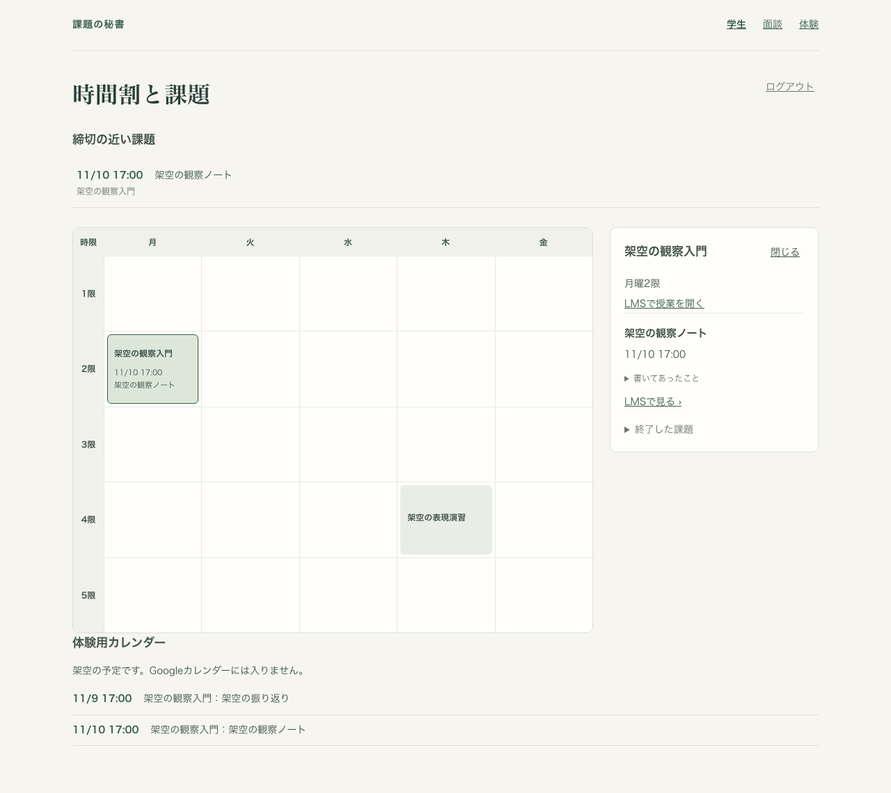

# Issue #47 ローカルの筋書きと体験用カレンダー

2026-11-06。対象は架空の体験用データ、Auth・Firestoreエミュレーター、Chromium。デプロイ先での操作と実物のGoogleカレンダーへの書き込みは実施していない。

## 結果

M6は初回測定（比較元なし）、**8/8、100%**。手順と結果は [m6.json](2026-11-06-issue-47/m6.json)。先生役で11/9 17:00から11/10 17:00へ延ばし、LMSを開くまでは台帳・保存済み予定・両画面が変わらないこと、開いた後は同じ予定IDで動くことを確認した。画面だけでなく保存先の予定と反映済みの版を照合した。

- `pnpm typecheck && pnpm lint && pnpm test && pnpm build && pnpm progress --check && pnpm check:samples`：成功。通常の試験は554件成功。専用エミュレーター向け試験は通常実行ではskipし、今回の体験経路は次のコマンドで別途実行した。
- `pnpm test:demo:emulator`：12件成功。本人判定、実物APIの403と接続の不変、普通の利用者の扱い、作成・変更・同時再送・取消・再出現、保存失敗時の未反映と再試行、未確認の削除中に課題が戻る場合を確認。
- `PLAYWRIGHT_MODULE=/path/to/playwright/index.mjs pnpm metrics:m6`：8手順成功。追加で390px幅、別ブラウザのログイン、ログアウト後の消去、ブラウザ例外0件も確認。Playwrightは既存の手元のランタイムを使用し、依存追加はない。
- `pnpm progress --write`：全体20/41、必須19/37。C34とC14のチェックは付けず、M6とローカルの証拠だけ追記。
- `check:samples`：17ファイル成功。手元の実物見本との比較は見本不在でskip。見本の正解ファイルは変更していない。

最初の追加試験は、認証済み観測の受領後に模擬の接続文書が存在せず失敗した。実装後に成功。既存の締切延長の同時実行試験は5秒の既定timeoutを超えたため、エミュレーター用コマンドを既存の観測試験と同じ20秒timeoutにした。正解や成否の条件は変更していない。ビルドは成功し、Webの500 kB超のchunk警告は残る。

## 画面

時間割の下に保存済みの予定を表示し、「体験用カレンダー」「Googleカレンダーには入りません」と示す。狭い画面では時間割の内側だけが横にスクロールし、予定の日時と題名は読める。

[390px幅の画面](2026-11-06-issue-47/calendar-narrow.png)

同じコード・試験・意図文書を固定したartifact検査でも筋書きを再実行し、画面を読んで確認した。run ID：`723f7832517547d4928f542b67d109c2`。これは実装者による確認であり、別系統のレビューではない。

## 残る確認

- #59完了後のデプロイ先での筋書きと、認証済み観測のFirestore保存（C34・C14）。今回のローカル成績を本番の成功として扱わない。
- 実物のGoogleカレンダーの操作（C15など）。M5の時間、実LMSのM4・M7は今回測っていない。読み取りの正解やM1・M3の測り方は対象外。
- 模擬予定は少量の架空データ用の1文書。自動の定期再試行や、実物のネットワークにおける障害復旧の実証は含めない。同期失敗時は観測を受領済みの場合があり、同じ「LMSを開く」で続きを試す。
- #59の`packages/server/scripts/seed-demo.mjs`と`docs/deploy.md`、依存・規則・デプロイ設定は変更していない。
