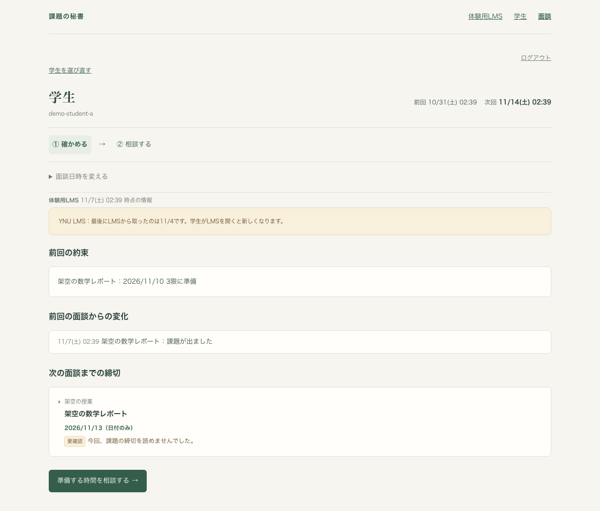
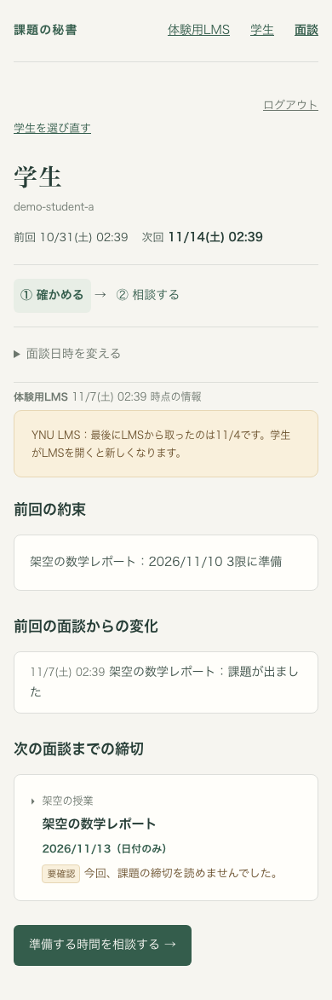

# Issue #94 取得状態の注意帯（2026-11-07）

## 対象と確認方法

架空の学生だけを使い、ローカルのAuth・Firestoreエミュレーター、API、Vite、Chromiumで面談画面の「① 確かめる」を確認した。実LMS・実Google・公開先には接続していない。判定と表示の決定は [D26](../decisions.md#d26-古い情報と取得の失敗を両方の画面で知らせる2026-11-07issue-94)。

- 単体試験：`pnpm --filter web test`。46件成功、エミュレーター専用2件は通常実行ではskip。
- 72時間直前（1ms前）は帯なし、ちょうど72時間で帯あり。部分成功・失敗・成功時刻なし、古さと失敗が重なる場合の判定も確認。学生画面の既存文言を維持する試験を追加。
- ブラウザ試験：`packages/server/scripts/seed-session.mjs` で手元の架空台帳を準備し、APIと `VITE_USE_FIREBASE_EMULATORS=true` のVite（5177）を起動後、`node packages/web/tests/session.browser.mjs` を実行。既存のガードに従い `GCLOUD_PROJECT=demo-kadai-hisho`、Firestore/Authのlocalhost接続、手元だけのランダムな `SESSION_DEMO_PASSWORD`、既存Playwrightへの `PLAYWRIGHT_MODULE`、画像の保存先 `ARTIFACT_EVIDENCE_DIR` を指定した。
- 結果：26操作成功、ブラウザエラー0。[操作一覧](2026-11-07-issue-94/operations.json)。従来24操作に注意帯の表示・失敗からの更新の2項目を追加した件数であり、改善率とは扱わない。
- Firestoreへ架空のYNU取得状態を追加し、最後の成功から72時間で帯を表示。1280幅・390幅の両方で横はみ出しなし。続けて取得失敗の文に変わり、成功すると帯が消えて従来の「時点の情報」に戻ることを、画面を開いたまま確認した。
- 既存の約束の試験データは、UTC日付の切り出しを日本時間の日付へ修正した。夜間に前回の約束が表示されない試験用データになる問題で、表示されるべき内容の判定は変更していない。

## 画面

両画像を目視し、注意帯の文言と折り返し、周囲の操作が読めることを確認した。

## 完成条件と指標

C23の既存チェックに今回の証拠を追記。新たに完了したC番号はなく、全体28/41・必須26/37を維持。M1〜M7は読み取り・解析・同期・体験の通しに関する指標で、今回は再測定していない。画面の分かりやすさの5段階評価は人による確認待ち。
